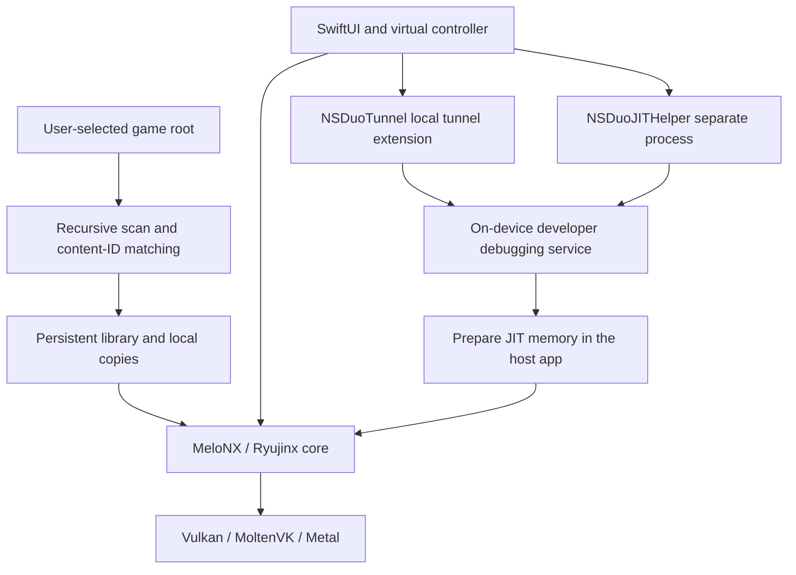

# NS Duo

[简体中文](README.md) | **English**

A streamlined Nintendo Switch emulator for iPhone Duo, built on **MeloNX / Ryujinx**. Import a game folder, associate its updates and DLC, prepare VPN and JIT inside the same app, then launch from your library.

> Experimental, developer-built software. A general-purpose core does not imply every game works. Compatibility, performance and JIT availability depend on the device, OS and game. This repository contains no games, console keys, firmware, pairing credentials or personal signing material.

## Features

- **Folder import:** XCI, NSP and NSZ, including recursively nested folders with arbitrary names.
- **Updates and DLC:** match content IDs to the base game; select the highest numeric update version and highest version per DLC ID. Check for changes before launch, when returning to the library and when the app becomes active.
- **Persistent library:** import once, tap to launch later; long-press to rename or remove a record.
- **NSZ conversion:** stream-decompress to a cached NSP on first import, with progress and cancellation, without modifying the source.
- **In-app preparation:** bundled local tunnel and separate JIT helper extensions, exposed as **Connect VPN** and **Enable JIT**, without switching between separate apps.
- **Duo layout:** approximately 60% game / 40% virtual controller in expanded portrait; full game area in landscape with an external controller. Compact pause/library controls at the top right, and subtle haptics on buttons other than sticks.
- **Simplified Chinese game language by default**, subject to game support.
- **Shader caching:** disk caching enabled for every game to reuse encountered shaders and reduce repeated compilation; not a guarantee of stutter-free play.

## Usage

### 1. First-time preparation

1. Build and install with **your own developer account**, following the instructions below, and enable Developer Mode on the device.
2. Import your own keys, firmware and **this phone's remote pairing record** in the preparation screen. Pairing data is distinct from game keys and from a traditional USB pairing record.
3. If the phone is not paired, consult upstream [StikDebug](https://github.com/StikDebug/StikDebug) / [StikPair](https://github.com/StikDebug/StikPair) instructions. NS Duo does not include a pairing server; initial pairing may require a computer.
4. Tap **Connect VPN**, approve the iOS VPN/local-network prompts, then tap **Enable JIT**. Initial developer-image preparation requires internet access; keep the app in the foreground.
5. Launch after the ready state appears. Other games in the same app process reuse that session. Force-quitting, system termination or a device restart requires preparation again.

After initial configuration, the intended flow uses the phone's bundled extensions to prepare JIT. OS changes, invalid pairing records and network conditions can still affect it.

### 2. Add a game

Use one root folder per game:

```text
Games/
└── One Game/               ← Select this folder in the app
    ├── Base.xci
    ├── Any Folder Name/
    │   └── Update.nsp
    └── More Content/
        └── Expansions/
            └── DLC.nsz
```

Choose **Add Game Folder**. Matching uses package metadata, not folder names. Put later updates/DLC anywhere inside the same root. Importing an individual base-game file is also supported; updates and DLC cannot launch independently.

The app stores security-scoped bookmarks and its own copies. If the external folder becomes unavailable, the last successful import is retained. Removing a source file does not automatically uninstall imported content. Removing a library entry preserves originals and saves; uninstalling the app deletes its local data. Reserve enough storage for decompressed NSZ content.

### 3. Pause, exit and save

Pause retains the running state within the current process. Returning to the library stops the current game and cleans up core resources. **It does not create an automatic save state or promise to resume at that exact point next time.** Save using the game's own save function before exiting.

## Build and install

The development setup used Apple Silicon macOS, Xcode 27.1 and .NET SDK 10.0.100, targeting iPhone Duo / iOS 27.2. Older toolchains and other device/OS combinations have not been fully validated. This workflow builds for a physical device only.

Prerequisites: an existing full Xcode installation, Python 3, Git, curl, and a developer account capable of provisioning the host and both extensions with the required capabilities. Generic entitlement declarations are included; personal Team IDs, certificates and provisioning profiles are not.

```bash
git clone https://github.com/RuanRuq/NSDou.git
cd NSDou

# Dependencies and caches stay inside the project.
bash tools/nsduo/setup-local.sh

# Replace these placeholders with your own values.
export NSDUO_TEAM_ID='YOUR_TEAM_ID'
export NSDUO_DEVICE_ID='YOUR_DEVICE_UDID'
export NSDUO_BUNDLE_ID='com.yourname.nsduo'
bash tools/nsduo/build-device.sh
```

- Override Xcode if needed: `export NSDUO_DEVELOPER_DIR='/Applications/Xcode.app/Contents/Developer'`.
- Project: `src/MeloNX/MeloNX.xcodeproj`; scheme: `MeloNX`; display name: **NS Duo**.
- Use the same development team for the host, `NSDuoTunnel` and `NSDuoJITHelper`. Extension IDs derive from the host bundle ID.
- Use the script for the first build: it rebuilds the patched StikJIT library, publishes the NativeAOT core, builds with Xcode and verifies the embedded binaries are current.
- Preserve `get-task-allow`, Network Extension capability and the core's memory entitlements. Distribution signing alone is not equivalent to development-debug signing; verify effective entitlements after signing.
- Output: `.build/DerivedData/Build/Products/Debug-iphoneos/MeloNX.app`.

Install on a connected, unlocked device:

```bash
source tools/nsduo/environment.sh
xcrun devicectl device install app --device "$NSDUO_DEVICE_ID" \
  .build/DerivedData/Build/Products/Debug-iphoneos/MeloNX.app
```

Launch from the phone's home screen and use the in-app JIT flow. Do not simultaneously attach the Xcode debugger to the host process.

Toolchains/NuGet caches live in `.toolchain/`; Xcode/Swift Package caches live in `.build/`. [Pinned dependency fetching](tools/nsduo/fetch-dependencies.py) verifies SHA-256 hashes instead of checking personal build outputs into Git. LibHac uses an explicitly mapped mirror feed; other NuGet packages come from NuGet.org. Global shell configuration and `xcode-select` remain unchanged.

## How it works



- **Emulation:** .NET NativeAOT embeds the C# core into the app; runtime JIT translates guest CPU instructions into executable host instructions. Graphics use Vulkan/MoltenVK/Metal.
- **Content:** Swift stores folder bookmarks and library metadata; a native bridge inspects packages. NSZ is decompressed with ZstdSharp before entering the same import pipeline.
- **Local VPN:** derived from LocalDevVPN's loopback approach, routing only the `10.7.0.1/32` development endpoint. It is not an internet proxy or game accelerator and sets no global default route.
- **JIT helper:** a process cannot debug-attach to itself, so a bundled extension communicates with local debugging services through StikJIT / idevice. Neither extension adds a home-screen app icon.
- **Readiness:** both helper completion and core memory initialization must succeed. NS Duo patches StikJIT's truncated page addresses and unchecked debugging replies; the modified sources are in `tools/nsduo/stikjit/`.

## Known limitations

- **Cellular-only cold starts** may fail to connect to local debugging services even when VPN status says connected. Prefer Wi-Fi for JIT preparation; local gameplay in the same prepared process does not require an ongoing debugger connection. Splitting the two buttons does not eliminate the cellular limitation; see the [upstream LocalDevVPN issue](https://github.com/jkcoxson/LocalDevVPN/issues/31).
- JIT uses OS developer services and private extension interfaces. It is not a permanent permission and needs revalidation after OS changes.
- Shader preloading can only use collected shaders; it cannot discover every shader a game will need before first play.
- No general save-state/full-process resume support. Multiplayer, universal compatibility and measured performance gains are not promised.
- The language switch applies to repository documentation. The customized app interface is primarily Chinese, not fully bilingual.

## Use with an AI Agent in one sentence

Copy this instruction to an agent with local filesystem and terminal access:

> Clone https://github.com/RuanRuq/NSDou into a separate directory, read README.en.md and the licenses, install dependencies only inside the project, check build prerequisites, then build and install NS Duo using the developer team, unique bundle ID and device identifier I provide; ask for missing inputs, do not change other projects or global settings, do not download games, keys or firmware, never upload signing or pairing material, and distinguish verified results from untested behavior.

This starts assisted setup; it does not replace device permission prompts, developer sign-in, valid pairing or user-supplied game material. No agent configuration, conversations or working-session records are included.

## Open-source acknowledgments

NS Duo depends on substantial upstream work. Thank you to the authors, maintainers and contributors of:

| Project | Role |
| --- | --- |
| [MeloNX](https://github.com/nurtrino/MeloNX) / [Ryujinx](https://git.ryujinx.app/ryubing/ryujinx) | iOS frontend foundation and CPU/GPU/system emulation; MeloNX mirror pinned to `f925129209afd55927a0201d82285b8fa4b7ba30` |
| [LocalDevVPN](https://github.com/jkcoxson/LocalDevVPN) | Local loopback tunnel code by **SideStore Team, Stossy11 and Magesh K**; NS Duo uses and modifies that code and is not an official LocalDevVPN product |
| [StikJIT](https://github.com/StikDebug/StikJIT) / [StikDebug](https://github.com/StikDebug/StikDebug) | Embedded JIT library, bundled scripts and integration approach; StikJIT 1.9.0, with local modifications supplied as source |
| [idevice](https://github.com/jkcoxson/idevice) | Apple device communications and debugging services by Jackson Coxson and contributors |
| [LibHac](https://github.com/Thealexbarney/LibHac) | Switch filesystems and content metadata |
| [NSZ](https://github.com/nicoboss/nsz) / [ZstdSharp](https://github.com/oleg-st/ZstdSharp) | Compressed container format reference and Zstandard decompression |
| [MoltenVK](https://github.com/KhronosGroup/MoltenVK) / [SDL](https://github.com/libsdl-org/SDL) | Apple graphics compatibility and multimedia foundation |
| [Melo-Controller](https://github.com/stossy11/Melo-Controller) / [NavigationStackBackport](https://github.com/lm/navigation-stack-backport) | Inherited controller and SwiftUI navigation dependencies |
| [FFmpeg](https://ffmpeg.org/) / [libvpx](https://chromium.googlesource.com/webm/libvpx/) / [teakra](https://github.com/wwylele/teakra) / [SPIRV-Cross](https://github.com/KhronosGroup/SPIRV-Cross) | Inherited media, DSP and shader components |

See [third-party notices](distribution/legal/THIRDPARTY.md) and [source/license details](docs/OPEN_SOURCE.md) for additional components. Initial research also referenced [ns-game-apple-arm-port](https://github.com/realskyrin/ns-game-apple-arm-port) and [d2r-mobile](https://github.com/jhaizhou-ops/d2r-mobile). Their game-specific runtime and address patches are not included in this general-purpose emulator.

## Licensing

Original NS Duo additions are MIT-licensed unless a file identifies a different origin or license. This is a multi-license source distribution: **the root MIT license does not cover every third-party component**. StikJIT is MPL-2.0, bundled StikDebug scripts retain AGPL-3.0, and LocalDevVPN retains its custom StosVPN license and attribution requirements. The MeloNX mirror's README says GPLv3 while its root LICENSE contains MIT; both notices and license texts are retained, without asserting a new license for third-party code. See [the full explanation](docs/OPEN_SOURCE.md).

NS Duo is independent of Nintendo, Apple and the upstream projects.
