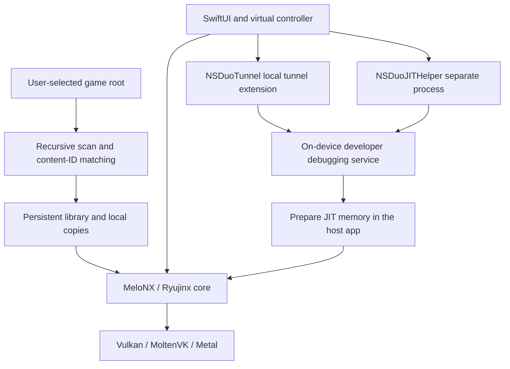

# NS Duo

[简体中文](README.md) | **English**

A streamlined Nintendo Switch emulator for iPhone Duo, built on **MeloNX / Ryujinx**. Import a game folder, associate its updates and DLC, prepare VPN and JIT inside the same app, then launch from your library.

> Experimental, developer-built software. A general-purpose core does not imply every game works. Compatibility, performance and JIT availability depend on the device, OS and game. This repository contains no games, console keys, firmware, pairing credentials or personal signing material.

## Usage statement

This project is intended for learning, technical research and knowledge sharing, with a focus on emulation principles, system interfaces and mobile adaptation.

**Non-commercial use request:** The maintainers ask that this project be used for non-commercial learning and research, rather than sales, paid distribution or other commercial monetization. This is a voluntary request, not an additional license condition. It does not change rights already granted under existing licenses; each component's applicable license governs its use.

Its purpose is not to play cracked games, distribute pirated content or facilitate infringement. It does not host or distribute those resource files.

**Users must obtain XCI, NSP and NSZ game files themselves through lawful means and ensure they have the rights required to use them.** This project does not supply these files. Required keys, firmware and other materials must also be lawfully provided by the user.

## Use with an AI Agent in one sentence

> Download [this project](https://github.com/RuanRuq/NSDuo) locally, then sign and install it on my currently connected phone using [Apple Developer account signing identity].

## What makes NS Duo convenient

NS Duo aims to simplify everyday use to: **choose a game folder once, then tap its cover to play.**

| When you want to… | How NS Duo helps |
| --- | --- |
| Play again | Keep library entries, local copies and cover art instead of selecting files every time. Rename games and use hold-to-remove protection. |
| Organize updates and DLC | Discover arbitrarily named subfolders, match content IDs automatically, and check for additions while the source folder remains accessible. |
| Prepare a session | Use the bundled local VPN and JIT helper inside the app. iOS / iPadOS 27+ supports first pairing on the device; older systems can import a computer-generated remote pairing record. |
| Use the Duo display | Keep the game centered above bottom-mounted touch controls in expanded portrait, use the full game area in landscape, and browse a cover grid. |
| Avoid repeating compilation work | Reuse shaders and compatible driver pipeline caches, reduce compilation waits between unrelated programs, and preserve resolution and rendering quality. First-time content may still stutter. |
| Investigate a gameplay issue | Collect diagnostics locally during normal play, then mark, export or clear records when needed, without keeping a computer connected for log capture. |

These additions focus on everyday workflow and the mobile experience. Compatibility still depends on the emulation core, game and OS; universal compatibility and 60 FPS are not promised.

## Features

- **Folder import:** XCI, NSP and NSZ, including recursively nested folders with arbitrary names.
- **Updates and DLC:** match content IDs to the base game; select the highest numeric update version and highest version per DLC ID. Check for changes before launch, when returning to the library and when the app becomes active.
- **Persistent library:** import once, tap to launch later; long-press to rename. Removal requires holding a button for five seconds, with border progress and gently increasing haptics.
- **Automatic cover art:** extract embedded game icons and cache thumbnails, including for existing library entries; show a controller placeholder when no icon is available.
- **NSZ conversion:** stream-decompress to a cached NSP on first import, with progress and cancellation, without modifying the source.
- **In-app preparation:** bundled local tunnel and separate JIT helper extensions, exposed as **Connect VPN** and **Enable JIT**. Without a pairing record, the JIT button guides first pairing on iOS / iPadOS 27+.
- **Duo layout:** the bottom 35% holds the portrait touch controller; the game viewport fits within 50% of the screen height and is centered in the upper 65%. Landscape uses the full game area with an external controller. Pause, library and close controls sit at the top left. They remain visible in portrait; tap that corner to reveal them in landscape and tap elsewhere in the game area to hide them.
- **Simplified Chinese game language by default**, subject to game support.
- **Shader and driver pipeline caching:** reuse encountered shaders and attempt to save new pipeline work at intervals of at least one minute when memory headroom permits and no recent memory warning is active, as well as on orderly shutdown. Validate device/driver compatibility and coordinate creation per shader program. Reclaim recreatable textures in bounded batches under memory pressure, avoiding GPU readbacks while paused. Resolution and drawing quality are preserved; first-time content may still stutter.
- **Phone motion input:** player one uses the phone sensors even with an external controller; other players retain their own controller sensors. The first sample after pause/backgrounding does not integrate rotation across the interruption.
- **Cheats:** long-press a game to edit your own Atmosphère codes, save choices by Build ID, select multiple functions and apply them to the suspended game. No game codes are bundled or downloaded.
- **Suspend and resume:** returning to the library pauses and retains the current game. Tap its card or the suspended-game indicator to continue. Switching games requires two confirmations and waits for the previous core to stop.
- **Asynchronous graphics submission:** enable MoltenVK asynchronous queue submission and log applied settings and graphics waits. Existing quality settings, locks and fences remain in place; performance and stability require device testing.
- **Local diagnostics:** record game activity, core exceptions, uncaught Objective-C exceptions and system-delivered MetricKit crash reports. Select multiple records to export, or clear logs; nothing is uploaded automatically.

## Usage

The minimum deployment target is **iOS 17.4** for the app, VPN extension and JIT helper. The full app has built successfully with this target. The currently available test device runs iOS 27.2; installation, JIT and gameplay on older systems still require testing on those OS versions.

### 1. First-time preparation

1. Build and install with **your own developer account**, following the instructions below, and enable Developer Mode on the device.
2. Import your own keys and firmware in the preparation screen. You may also import an existing **remote pairing record for this device**, distinct from game keys and traditional USB pairing records.
3. On iOS / iPadOS 27+, use the first-time JIT button when no record exists and allow local-network access. Once ready, NS Duo attempts to open Developer Mode; a manual settings button is also available. If the system does not navigate directly, open Settings → Privacy & Security → Developer Mode and choose **Pair with NS Duo**. Enter the **device unlock passcode** first, return to NS Duo to read its **six-digit pairing code**, then enter that code in Settings. Confirm the record was saved before continuing. First pairing does not require the VPN; keep the app alive during pairing. Older systems require a computer-generated remote pairing record.
4. Tap **Connect VPN**, approve the iOS VPN/local-network prompts, then tap **Enable JIT**. Initial developer-image preparation requires internet access; keep the app in the foreground.
5. Launch after the ready state appears. Other games in the same app process reuse that session. Force-quitting, system termination or a device restart requires preparation again.

After initial configuration, the intended flow uses the phone's bundled extensions to prepare JIT. OS changes, invalid pairing records and network conditions can still affect it.

When preparing the runtime environment, you can also consult the third-party [Keys reference](https://prodkeys.io/prod-keys-download/) and [firmware reference](https://prodkeys.io/switch-firmware-download/) for file descriptions and version information. These links are provided as external references; please obtain the required files lawfully yourself.

### 2. Add a game

Use one root folder per game:

```text
Games/
└── One Game/               ← Select this folder in the app
    ├── Base.xci
    ├── Any Folder Name/
    │   └── Update.nsp
    └── More Content/
        └── Expansions/
            └── DLC.nsz
```

Choose **Add Game Folder**. Matching uses package metadata, not folder names. Put later updates/DLC anywhere inside the same root. Importing an individual base-game file is also supported; updates and DLC cannot launch independently.

The app stores security-scoped bookmarks and its own copies. If the external folder becomes unavailable, it launches the validated local copies directly, without a missing-source or cached-version confirmation. Removing a source file does not automatically uninstall imported content. New updates or DLC cannot be discovered while the source is inaccessible; add that game's folder again to restore scanning. Missing or invalid app-owned content still produces an error. Reserve enough storage for decompressed NSZ content.

Long-press a game card, choose removal, then continuously hold the confirmation button for five seconds. Releasing, moving off the button or backgrounding cancels the hold. Removing a library entry preserves originals and saves; uninstalling the app deletes its local data.

### 3. Pause, exit and save

**Pause** keeps the running state in the current process. **Return to Library** suspends the game while retaining its thread and view. Tap its card or the suspended-game indicator at the top right to resume the same session. Game import, preparation changes and removal of the current game are unavailable while suspended; becoming active does not resume automatically.

**Close Game** ends the session after confirmation. Selecting another game requires confirmation of the switch and of closing the current session, then waits for the old core to stop. If backgrounded during shutdown, the next launch waits until the app is active again.

**Suspension works only within the current app process; it is not a save state.** Closing the game, system termination or restarting the device loses that suspended session. Use the game’s own save function.

### 4. Review and clear logs

Open diagnostic logs from the library menu, select one, several or all records, and export through the system share sheet, including AirDrop. Logs live in the app’s `Documents/Diagnostics`, with size rotation and bounded retention; export records you want to keep long-term. Clearing logs removes only local diagnostic records and temporary exports, preserves games and saves, and allows future recording.

Core exceptions have separate bounded files, and system reports can include redacted call stacks. MetricKit delivery may be delayed until the app reopens; its reporting period does not identify an exact crash time or game session. System kills and memory exhaustion may leave no stack. Long-frame and interrupted-session markers remain diagnostic clues. See the [regression-check documentation](tools/nsduo/tests/README.md) for coverage and limits.

See [graphics submission and wait diagnostics](docs/graphics-diagnostics.md) for configuration readback, timing fields and interpretation limits. Signal ABI and title-specific checked-memory changes still require actual gameplay verification.

### 5. Edit and enable cheats

Long-press a game and choose cheat editing. Enter the 16-character Build ID from the original code filename and paste Atmosphère content for that version, using `[function name]` and `{master code name}` sections. The editor restores saved source text; new or changed functions default to disabled. A running, suspended game can supply its Build ID. A version mismatch or compilation failure preserves the previous configuration.

Select functions in the enable-cheats sheet. For a stopped game, save choices for the next launch. For the suspended current game, apply and return to continue the same session. Master sections are enabled with selected functions and execute first. Scene-dependent or button-triggered codes retain their original conditions. Disabling a function stops future writes but may not restore values already changed.

The new native cheat interface requires rebuilding the core and app from current sources before device testing; an old core cannot provide it. This synchronization performs static validation only, with no new app build or device run.

## Build and install

The development setup used Apple Silicon macOS, Xcode 27.1 and .NET SDK 10.0.100, targeting iPhone Duo / iOS 27.2. Older toolchains and other device/OS combinations have not been fully validated. This workflow builds for a physical device only.

Prerequisites: an existing full Xcode installation, Python 3, Git, curl, and a developer account capable of provisioning the host and both extensions with the required capabilities. Generic entitlement declarations are included; personal Team IDs, certificates and provisioning profiles are not.

```bash
git clone https://github.com/RuanRuq/NSDuo.git
cd NSDuo

# Dependencies and caches stay inside the project.
bash tools/nsduo/setup-local.sh

# Replace these placeholders with your own values.
export NSDUO_TEAM_ID='YOUR_TEAM_ID'
export NSDUO_DEVICE_ID='YOUR_DEVICE_UDID'
export NSDUO_BUNDLE_ID='com.yourname.nsduo'
bash tools/nsduo/build-device.sh
```

- Override Xcode if needed: `export NSDUO_DEVELOPER_DIR='/Applications/Xcode.app/Contents/Developer'`.
- Project: `src/MeloNX/MeloNX.xcodeproj`; scheme: `MeloNX`; display name: **NS Duo**.
- Use the same development team for the host, `NSDuoTunnel` and `NSDuoJITHelper`. Extension IDs derive from the host bundle ID.
- Use the script for the first build: it rebuilds the patched StikJIT library, publishes the NativeAOT core, builds with Xcode and verifies the embedded binaries are current.
- Preserve `get-task-allow`, Network Extension capability and the core's memory entitlements. Distribution signing alone is not equivalent to development-debug signing; verify effective entitlements after signing.
- Output: `.build/DerivedData/Build/Products/Debug-iphoneos/MeloNX.app`.

### Sign the release IPA yourself

The release IPA is unsigned. To use both the built-in VPN and JIT, sign with one Apple development team that supports Network Extensions and keep both extensions. The app and VPN extension both need `packet-tunnel-provider` in their signatures and profiles, and the app also needs `get-task-allow`. A free Apple ID cannot provision Packet Tunnel for the built-in VPN, and distribution signing does not grant development debugging permissions.

After signing, extract the IPA and check the app in `Payload` from the repository root:

```bash
python3 tools/nsduo/verify-device-signing.py '/path/to/Payload/MeloNX.app'
```

The script reports missing permissions, expired profiles and signing mismatches. Test VPN and JIT on your device after installation.

Install on a connected, unlocked device:

```bash
source tools/nsduo/environment.sh
xcrun devicectl device install app --device "$NSDUO_DEVICE_ID" \
  .build/DerivedData/Build/Products/Debug-iphoneos/MeloNX.app
```

Launch from the phone's home screen and use the in-app JIT flow. Do not simultaneously attach the Xcode debugger to the host process.

Toolchains/NuGet caches live in `.toolchain/`; Xcode/Swift Package caches live in `.build/`. [Pinned dependency fetching](tools/nsduo/fetch-dependencies.py) verifies SHA-256 hashes instead of checking personal build outputs into Git. LibHac uses an explicitly mapped mirror feed; other NuGet packages come from NuGet.org. Global shell configuration and `xcode-select` remain unchanged.

## How it works



- **Emulation:** .NET NativeAOT embeds the C# core into the app; runtime JIT translates guest CPU instructions into executable host instructions. Graphics use Vulkan/MoltenVK/Metal.
- **Content:** Swift stores folder bookmarks and library metadata; a native bridge inspects packages. NSZ is decompressed with ZstdSharp before entering the same import pipeline.
- **Local VPN:** derived from LocalDevVPN's loopback approach, routing only the `10.7.0.1/32` development endpoint. It is not an internet proxy or game accelerator and sets no global default route.
- **JIT helper:** a process cannot debug-attach to itself, so a bundled extension communicates with local debugging services through StikJIT / idevice. Neither extension adds a home-screen app icon.
- **Readiness:** both helper completion and core memory initialization must succeed. NS Duo patches StikJIT's truncated page addresses and unchecked debugging replies; the modified sources are in `tools/nsduo/stikjit/`.

## Known limitations

- **Cellular-only cold starts** may fail to connect to local debugging services even when VPN status says connected. Prefer Wi-Fi for JIT preparation; local gameplay in the same prepared process does not require an ongoing debugger connection. Splitting the two buttons does not eliminate the cellular limitation; see the [upstream LocalDevVPN issue](https://github.com/jkcoxson/LocalDevVPN/issues/31).
- **When Wi-Fi is unavailable**, you can try this sequence: connect the VPN → turn on Airplane Mode → enable JIT → wait until JIT is ready → turn off Airplane Mode, then launch the game. Whether this workaround succeeds depends on the device and OS version.
- JIT uses OS developer services and private extension interfaces. It is not a permanent permission and needs revalidation after OS changes.
- Shader preloading can only use collected shaders; it cannot discover every shader a game will need before first play.
- No general save-state/full-process resume support. Multiplayer, universal compatibility and measured performance gains are not promised.
- There is no universal 60 FPS unlock. Games that natively support 60 FPS still depend on available performance; 30 FPS games may need patches matching their exact version. Changing display refresh rate or VSync does not guarantee normal-speed 60 FPS gameplay.
- The language switch applies to repository documentation. The customized app interface is primarily Chinese, not fully bilingual.

## Open-source acknowledgments

NS Duo depends on substantial upstream work. Thank you to the authors, maintainers and contributors of:

| Project | Role |
| --- | --- |
| [MeloNX](https://github.com/nurtrino/MeloNX) / [Ryujinx](https://git.ryujinx.app/ryubing/ryujinx) | iOS frontend foundation and CPU/GPU/system emulation; MeloNX mirror pinned to `f925129209afd55927a0201d82285b8fa4b7ba30` |
| [LocalDevVPN](https://github.com/jkcoxson/LocalDevVPN) | Local loopback tunnel code by **SideStore Team, Stossy11 and Magesh K**; NS Duo uses and modifies that code and is not an official LocalDevVPN product |
| [StikJIT](https://github.com/StikDebug/StikJIT) / [StikDebug](https://github.com/StikDebug/StikDebug) | Embedded JIT library, bundled scripts and integration approach; StikJIT 1.9.0, with local modifications supplied as source |
| [idevice](https://github.com/jkcoxson/idevice) | Apple device communications and debugging services by Jackson Coxson and contributors |
| [LibHac](https://github.com/Thealexbarney/LibHac) | Switch filesystems and content metadata |
| [NSZ](https://github.com/nicoboss/nsz) / [ZstdSharp](https://github.com/oleg-st/ZstdSharp) | Compressed container format reference and Zstandard decompression |
| [MoltenVK](https://github.com/KhronosGroup/MoltenVK) / [SDL](https://github.com/libsdl-org/SDL) | Apple graphics compatibility and multimedia foundation |
| [Melo-Controller](https://github.com/stossy11/Melo-Controller) / [NavigationStackBackport](https://github.com/lm/navigation-stack-backport) | Inherited controller and SwiftUI navigation dependencies |
| [FFmpeg](https://ffmpeg.org/) / [libvpx](https://chromium.googlesource.com/webm/libvpx/) / [teakra](https://github.com/wwylele/teakra) / [SPIRV-Cross](https://github.com/KhronosGroup/SPIRV-Cross) | Inherited media, DSP and shader components |

See [third-party notices](distribution/legal/THIRDPARTY.md) and [source/license details](docs/OPEN_SOURCE.md) for additional components. Initial research also referenced [ns-game-apple-arm-port](https://github.com/realskyrin/ns-game-apple-arm-port) and [d2r-mobile](https://github.com/jhaizhou-ops/d2r-mobile). Their game-specific runtime and address patches are not included in this general-purpose emulator.

## Licensing

Original NS Duo additions are MIT-licensed unless a file identifies a different origin or license. This is a multi-license source distribution: **the root MIT license does not cover every third-party component**. StikJIT is MPL-2.0, bundled StikDebug scripts retain AGPL-3.0, and LocalDevVPN retains its custom StosVPN license and attribution requirements. The MeloNX mirror's README says GPLv3 while its root LICENSE contains MIT; both notices and license texts are retained, without asserting a new license for third-party code. See [the full explanation](docs/OPEN_SOURCE.md).

NS Duo is independent of Nintendo, Apple and the upstream projects.
