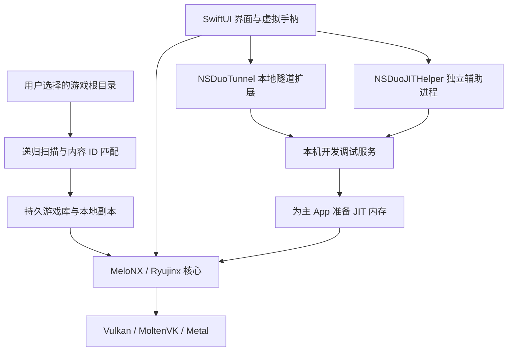

# NS Duo

**简体中文** | [English](README.en.md)

面向 iPhone Duo 的极简 Nintendo Switch 模拟器，基于 **MeloNX / Ryujinx**。选择游戏目录后，自动整理本体、更新与 DLC；在同一个 App 内完成 VPN 和 JIT 准备，再从游戏库启动。

> 当前为开发者自行构建的实验性版本。通用模拟核心不代表所有游戏都能运行；兼容性、性能与 JIT 可用性取决于设备、系统和游戏。仓库不提供游戏、密钥、固件、配对凭据或个人签名资料。

## 使用声明

本项目用于学习知识、技术研究与交流，重点是理解模拟器原理、系统接口和移动端适配。

**非商业用途倡议：** 维护者倡议将本项目用于非商业的学习与研究，请勿将其用于售卖、收费分发或其他商业获利活动。这是一项自愿遵循的用途倡议，不增加许可证条件，也不改变现有许可证已授予的权利；实际使用权以各组件适用的许可证为准。

项目不以游玩破解游戏、传播盗版或协助侵权为目的，不托管或分发相关资源文件。

**XCI、NSP、NSZ 等游戏文件需要使用者自行通过合法途径取得，并确认具有相应使用权。** 本项目不提供这些文件；运行所需的密钥、固件等资料也需自行合法准备。

## 让 AI Agent 一句话使用项目

> 把[https://github.com/RuanRuq/NSDuo](https://github.com/RuanRuq/NSDuo)这个项目下载到本地，然后使用[苹果开发者账号的签名]安装到我正在连接的手机上

## 项目特色与便利

NS Duo 希望把日常使用简化为：**首次选择游戏目录，以后点击封面启动。**

| 使用场景 | NS Duo 提供的便利 |
| --- | --- |
| 再次游玩 | 保存游戏记录、本地副本和封面，无需每次重新选择文件；支持重命名和长按防误删。 |
| 整理更新与 DLC | 递归识别任意名称的子文件夹，按内容 ID 自动匹配，并在可访问的源目录中检查新增内容。 |
| 准备运行 | 本地 VPN 与独立 JIT helper 集成在同一个 App；iOS / iPadOS 27+ 可在手机内完成首次配对，旧系统支持导入电脑生成的远程配对记录。 |
| 使用 Duo 屏幕 | 展开竖屏的游戏画面居中、虚拟手柄固定在底部；横屏显示完整游戏区，封面网格便于选择游戏。 |
| 减少重复编译 | 复用着色器和兼容的驱动管线缓存，减少无关程序之间的编译等待，保留分辨率与绘制质量；首次新内容仍可能卡顿。 |
| 排查游玩问题 | 平常游玩自动留下本地诊断记录，需要时再标记、导出分析或清除，无需一直连接电脑采集日志。 |

这些改动侧重操作流程和移动端体验。兼容性仍由模拟核心、游戏与系统共同决定，不承诺全游戏兼容或统一 60 帧。

## 功能

- **目录导入**：支持 XCI、NSP、NSZ；递归扫描同一游戏目录下任意名称的子文件夹。
- **更新与 DLC**：按内容 ID 匹配本体，选择最高数字版本的更新及同 ID DLC；启动前、返回游戏库和 App 回到前台时检查文件变化。
- **保留游戏记录**：首次导入后直接点击卡片启动，可长按重命名；移除需持续按住按钮 5 秒，边框显示进度并伴随逐渐增强的轻微震动。
- **自动游戏封面**：读取游戏包内置图标并缓存为缩略图，已有游戏自动补齐；缺少图标时显示手柄占位图。
- **NSZ 解压**：首次导入时流式转换为 NSP 并缓存，支持进度和取消；不改动原文件。
- **App 内运行准备**：内置本地隧道扩展和独立 JIT 辅助扩展，分为「连接 VPN」「开启 JIT」两个按钮；没有配对记录时，后者显示「首次开启 JIT」，引导 iOS / iPadOS 27+ 完成本机配对。
- **Duo 布局**：展开竖屏底部 35% 为虚拟手柄区；游戏视口按屏幕 50% 高度适配，并在上方 65% 区域内居中。横屏显示完整游戏区，使用外接手柄。暂停、返回游戏库和关闭游戏位于左上角；竖屏常显，横屏点击左上角唤出，点击游戏区其他位置隐藏。
- **游戏默认简体中文**：实际语言仍取决于游戏支持范围。
- **着色器与驱动管线缓存**：复用已遇到的着色器，在内存充足且没有近期内存警告时，每隔至少一分钟尝试保存新增管线缓存，并在正常结束时再次保存；校验设备与驱动兼容性，合并重复编译请求，按着色器程序协调创建。内存紧张时分批回收可重建的纹理，暂停期间避免 GPU 回读；不降低分辨率或跳过绘制。首次遇到新内容仍可能卡顿。
- **手机体感**：玩家一使用手机传感器，连接外接手柄后也可使用；其他玩家保留各自手柄的体感。暂停或切后台后的首个样本不累计中断期间的旋转。
- **金手指**：长按游戏卡片可编辑用户自己的 Atmosphère 代码，按 Build ID 保存并选择多个功能，支持对当前挂起游戏应用；不内置或下载游戏代码。
- **挂起与恢复**：返回游戏库暂停并保留当前游戏，点击「游戏已挂起」或原游戏卡片继续；切换到另一款游戏需两次确认，并等待旧核心完全关闭。
- **异步图形提交与诊断**：启用 MoltenVK 异步队列提交，记录实际配置和图形等待耗时；画质、原有锁与 fence 保持原有设置。性能与稳定性仍待真机验证。
- **本地诊断日志**：自动记录游戏运行、核心异常、Objective-C 未捕获异常及系统交付的 MetricKit 崩溃报告，支持多选导出或清除，不自动上传。

## 使用方法

最低部署版本为 **iOS 17.4**，包含主 App、VPN 扩展和 JIT helper。17.4 目标已通过完整编译；当前可用真机为 iOS 27.2，旧系统上的安装、JIT 和游戏运行尚待对应真机验证。

### 1. 首次准备

1. 按下方构建说明，使用**你自己的开发者账号**安装 NS Duo，并在设备上启用开发者模式。
2. 在 App 的运行准备中导入自己提供的密钥和固件。已有**这台手机的远程配对记录**也可直接导入；它不同于游戏密钥和传统 USB 配对记录。
3. iOS / iPadOS 27+ 没有配对记录时，点击「首次开启 JIT」，允许本地网络访问。配对服务就绪后会尝试打开开发者模式，也可点击「前往设置 · 开发者模式」；若系统未直达，请手动进入设置 → 隐私与安全性 → 开发者模式，选择「与 NS Duo 配对」。先输入**设备解锁密码**；验证通过后返回 NS Duo，查看六位**本机配对码**，再回到系统设置输入该码。确认记录已保存后继续下一步。首次配对无需先连接 VPN，期间请勿从多任务中关闭 App。旧系统需导入电脑生成的远程配对记录。
4. 点「连接 VPN」，按 iOS 提示允许添加 VPN 和访问本地网络；然后点「开启 JIT」。首次准备开发者镜像需要联网，请保持 App 在前台。
5. 显示就绪后启动游戏；同一 App 进程中的后续游戏无需重新开启 JIT。完全退出、被系统终止或重启设备后需要重新准备。

初次配置完成后，设计目标是通过手机内置扩展准备 JIT；系统变化、配对失效和网络环境仍可能影响此流程。

准备运行环境时，也可借助 [Keys 相关资料](https://prodkeys.io/prod-keys-download/) 与 [固件版本资料](https://prodkeys.io/switch-firmware-download/) 查阅文件说明和版本信息。链接仅作外部资料参考，所需文件请自行合法准备。

### 2. 添加游戏

一个根目录对应一个游戏，例如：

```text
我的游戏/
└── 某个游戏/             ← 在 App 中选择这一层
    ├── 本体.xci
    ├── 任意名称的目录/
    │   └── 更新.nsp
    └── 其他内容/
        └── 扩展包/
            └── DLC.nsz
```

点击「添加游戏文件夹」选择根目录。文件夹名称不参与识别，匹配依据是包内元数据。新的更新或 DLC 放回同一根目录或其子目录即可。也支持单独添加一个游戏本体文件；更新和 DLC 不能单独启动。

App 保存访问书签与自己的副本。外部目录失效时会直接使用已验证的本地副本启动，不再弹出源文件找不到或继续使用导入版本的确认；删除源文件不会自动卸载已导入内容。源目录不可访问期间无法发现新增更新或 DLC，重新添加该游戏目录后可继续检查。真正缺失或损坏的 App 内文件仍会提示错误。NSZ 解压需要按解压后的大小预留空间。

长按游戏卡片并选择「移除游戏」后，持续按住确认按钮 5 秒才会移除；松手、移出按钮或切后台会取消。移除游戏保留原文件与存档；卸载整个 App 会删除本地数据。

### 3. 暂停、退出与存档

「暂停」保留当前进程中的运行状态；「返回游戏库」会暂停并挂起当前游戏，保留原线程与画面。库右上方显示「游戏已挂起」，点击提示或原游戏卡片可继续同一局。挂起期间不能导入游戏、修改运行准备或移除当前游戏；切回 App 不会自动恢复。

「关闭游戏」确认后结束当前线程；点击另一款游戏会先确认切换，再确认关闭当前游戏，旧核心完全结束后才启动下一款。关闭期间退到后台会保留启动请求，回到前台后再继续。

**挂起只在当前 App 进程内有效，不是即时存档。** 系统结束进程、关闭游戏或重启设备后不能恢复这一局，请使用游戏自身的保存功能。

### 4. 查看与清除日志

在游戏库菜单打开「诊断日志」，选择一条、多条或全部记录，再通过系统分享菜单导出或隔空投送。日志位于 App 的 `Documents/Diagnostics`，按大小轮转并限制保留数量；需要长期保留的记录请及时导出。「清除日志」只删除本机诊断记录和临时导出文件，不删除游戏或存档，之后仍会自动收集新的记录。

核心异常另存于有大小上限的异常文件，系统报告可附带脱敏后的调用栈。MetricKit 报告可能在重开 App 后延迟出现，统计区间不代表某一局的精确崩溃时间；系统强杀或内存耗尽也不保证留下堆栈。长帧和未正常结束标记只是排查线索。相关检查与记录范围见[回归检查说明](tools/nsduo/tests/README.md)。

图形诊断的配置读回、各计时字段及解释边界见[图形提交与等待诊断](docs/graphics-diagnostics.md)。iOS 信号接口和特定游戏的受检内存策略仍不能替代实际游戏验证。

### 5. 编辑与启用金手指

长按游戏卡片，选择「编辑金手指」，填写原代码文件名中的 16 位 Build ID，粘贴对应版本的 Atmosphère 内容；支持 `[功能名称]` 和 `{基础代码名称}` 分段。编辑页保留上次保存的原文，新增或代码已变化的功能默认关闭。已运行并挂起的游戏可自动读取 Build ID；版本不匹配或编译失败时保留原配置。

在「启用金手指」中选择功能。未运行时保存供下次启动恢复；当前游戏挂起时，点击「应用并返回游戏」更新开关并继续同一局。基础代码随所选功能启用，依赖场景或组合键的代码仍需满足原触发条件。关闭开关仅停止后续写入，已改变的数值不保证恢复。

本次新增原生金手指接口，安装测试前需从当前源码重新生成核心并构建 App，不能继续链接旧核心。本轮同步只做静态验证，未重新构建或运行真机。

## 构建与安装

已使用的开发环境为 Apple Silicon Mac、Xcode 27.1、.NET SDK 10.0.100；目标设备为 iPhone Duo / iOS 27.2。较旧的工具链、其他设备和系统组合未完整验证。本流程仅构建真机目标。

需要已有完整 Xcode、Python 3、Git、curl，以及能够为主 App 和两个扩展配置所需能力的开发者账号。工程保留通用 entitlements；不含任何个人 Team ID、证书或描述文件。

```bash
git clone https://github.com/RuanRuq/NSDuo.git
cd NSDuo

# 依赖与缓存均放在工程内；不会修改全局 shell 或 xcode-select。
bash tools/nsduo/setup-local.sh

# 以下均替换为自己的信息。
export NSDUO_TEAM_ID='YOUR_TEAM_ID'
export NSDUO_DEVICE_ID='YOUR_DEVICE_UDID'
export NSDUO_BUNDLE_ID='com.yourname.nsduo'
bash tools/nsduo/build-device.sh
```

- 如需指定另一份 Xcode：`export NSDUO_DEVELOPER_DIR='/Applications/Xcode.app/Contents/Developer'`。
- 打开工程：`src/MeloNX/MeloNX.xcodeproj`，Scheme：`MeloNX`。桌面显示名为 **NS Duo**。
- 主 App、`NSDuoTunnel`、`NSDuoJITHelper` 使用同一开发团队；扩展标识由主 Bundle ID 派生。
- 首次构建建议使用上述脚本：它会先重建修正后的 StikJIT、编译 NativeAOT 核心，再交给 Xcode 打包，并检查嵌入二进制是否为当前版本。
- 必须保留开发调试权限 `get-task-allow`、网络扩展及核心所需内存权限。普通发行签名不等同于可用的开发调试签名。应核对实际签名后的权限，而非只看源码。
- 构建产物：`.build/DerivedData/Build/Products/Debug-iphoneos/MeloNX.app`。

### 自行签装 Release IPA

Release 的 IPA 未签名。要使用内置 VPN 和 JIT，请使用同一个具备 Network Extensions 能力的 Apple 开发团队签名，并保留两个扩展。主 App 和 VPN 扩展的签名及各自的描述文件都需要 `packet-tunnel-provider`，主 App 还需要 `get-task-allow`。免费 Apple ID 无法为内置 VPN 提供 Packet Tunnel；普通分发签名也不提供开发调试权限。

签完后解压 IPA，在工程根目录检查 `Payload` 里的 App：

```bash
python3 tools/nsduo/verify-device-signing.py '/解压目录/Payload/MeloNX.app'
```

脚本会指出哪个组件缺权限、描述文件过期或签名信息不匹配。VPN 和 JIT 是否能在设备上运行，仍需安装后验证。

安装到已连接且解锁的设备：

```bash
source tools/nsduo/environment.sh
xcrun devicectl device install app --device "$NSDUO_DEVICE_ID" \
  .build/DerivedData/Build/Products/Debug-iphoneos/MeloNX.app
```

安装后从手机桌面打开 App，使用内置 JIT 流程；不要同时让 Xcode 调试器附加到主进程。

工具链、NuGet 缓存位于 `.toolchain/`，Xcode/Swift Package 缓存位于 `.build/`。第三方原生依赖由 [固定版本下载脚本](tools/nsduo/fetch-dependencies.py) 获取并核验 SHA-256，不将个人构建产物上传到仓库。LibHac 使用显式映射的镜像源，其余 NuGet 包使用 NuGet.org。

## 工作原理



- **模拟执行**：C# 核心通过 .NET NativeAOT 编译进 App，运行时 JIT 负责将游戏 CPU 指令转换为可执行的宿主指令；渲染经 Vulkan/MoltenVK 到 Metal。
- **文件管理**：Swift 层保存目录书签和游戏记录，原生桥接读取包内元数据；NSZ 使用 ZstdSharp 解压后进入相同导入流程。
- **本地 VPN**：基于 LocalDevVPN 的回环思路，只路由 `10.7.0.1/32` 开发端点，不是翻墙或游戏加速服务，不设置全局默认路由。
- **独立 JIT 辅助**：主进程不能自己附加调试自己，因此随包安装独立扩展，通过 StikJIT / idevice 与本机调试服务通信。两个扩展没有额外桌面图标。
- **就绪判定**：同时验证辅助操作结果和核心内存初始化；本项目修正了 StikJIT 页地址截断和未检查调试响应的问题，相关修改源码位于 `tools/nsduo/stikjit/`。

## 已知限制

- **纯蜂窝冷启动**可能无法建立本地调试连接，即使 VPN 显示已连接。建议先在 Wi-Fi 下完成 JIT；准备完成后同一进程运行本地游戏不依赖持续的调试连接。分开两个按钮并不意味着彻底解决了蜂窝限制，参见 [LocalDevVPN 上游问题](https://github.com/jkcoxson/LocalDevVPN/issues/31)。
- **没有 Wi-Fi 环境时**，可尝试按顺序操作：连接 VPN → 开启飞行模式 → 启动 JIT → 等待 JIT 准备完成 → 关闭飞行模式，再启动游戏。此方法的可用性取决于设备和系统版本。
- JIT 涉及系统开发服务与私有扩展接口；不是永久权限，系统升级后需要重新验证。
- 着色器缓存只能预热已收集的内容，不能在第一次运行前知道整款游戏将使用的全部着色器。
- 尚无通用即时存档/完整运行现场恢复；网络联机、全游戏兼容性和性能提升没有统一保证。
- 没有通用的全游戏 60 帧解锁。原生支持 60 帧的游戏仍取决于运行性能；锁定 30 帧的游戏可能需要匹配版本的专用补丁。改变屏幕刷新率或垂直同步不保证得到正常速度的 60 帧。
- 中文/English 切换指本仓库文档；当前定制界面以中文为主，不代表 App 已全面双语化。

## 开源来源与感谢

NS Duo 的模拟能力建立在上游长期工作之上。感谢以下项目的作者、维护者和贡献者：

| 项目 | 本项目中的用途 |
| --- | --- |
| [MeloNX](https://github.com/nurtrino/MeloNX) / [Ryujinx](https://git.ryujinx.app/ryubing/ryujinx) | iOS 前端基础、CPU/GPU/系统模拟核心；使用 MeloNX 镜像固定提交 `f925129209afd55927a0201d82285b8fa4b7ba30` |
| [LocalDevVPN](https://github.com/jkcoxson/LocalDevVPN) | 本地回环隧道代码；感谢 **SideStore Team、Stossy11、Magesh K**；NS Duo 使用并修改了该项目代码，并非其官方产品 |
| [StikJIT](https://github.com/StikDebug/StikJIT) / [StikDebug](https://github.com/StikDebug/StikDebug) | 内嵌 JIT 库、随附调试脚本及集成思路；StikJIT 固定 1.9.0，局部修改随源码提供 |
| [idevice](https://github.com/jkcoxson/idevice) | Apple 设备通信与调试服务；感谢 Jackson Coxson 及贡献者 |
| [LibHac](https://github.com/Thealexbarney/LibHac) | Switch 文件系统、内容元数据 |
| [NSZ](https://github.com/nicoboss/nsz) / [ZstdSharp](https://github.com/oleg-st/ZstdSharp) | 压缩容器格式参考与 Zstandard 解压 |
| [MoltenVK](https://github.com/KhronosGroup/MoltenVK) / [SDL](https://github.com/libsdl-org/SDL) | Apple 平台图形兼容及多媒体基础 |
| [Melo-Controller](https://github.com/stossy11/Melo-Controller) / [NavigationStackBackport](https://github.com/lm/navigation-stack-backport) | 上游控制器和 SwiftUI 导航依赖 |
| [FFmpeg](https://ffmpeg.org/) / [libvpx](https://chromium.googlesource.com/webm/libvpx/) / [teakra](https://github.com/wwylele/teakra) / [SPIRV-Cross](https://github.com/KhronosGroup/SPIRV-Cross) | 上游媒体、DSP 和着色器组件 |

其他继承组件与版权见 [第三方许可证](distribution/legal/THIRDPARTY.md) 和 [来源与许可说明](docs/OPEN_SOURCE.md)。最初调研参考了 [ns-game-apple-arm-port](https://github.com/realskyrin/ns-game-apple-arm-port) 与 [d2r-mobile](https://github.com/jhaizhou-ops/d2r-mobile)；当前工程未采用其游戏专用运行层或地址补丁，使用的是通用模拟核心。

## 许可

NS Duo 原创增量代码按 MIT 提供，带有独立声明或来源的文件继续适用其原许可。这里是多许可证源码集合，**根目录 MIT 许可不能覆盖所有第三方组件**：StikJIT 为 MPL-2.0，随附 StikDebug 脚本为 AGPL-3.0，LocalDevVPN 保留自定义 StosVPN 许可及署名要求。MeloNX 镜像的 README 与根 LICENSE 存在 GPLv3/MIT 文案差异，本项目保留双方声明和许可文本，不据此重授第三方代码许可。详见 [完整说明](docs/OPEN_SOURCE.md)。

NS Duo 是独立项目，不隶属于 Nintendo、Apple 或上述上游项目。
